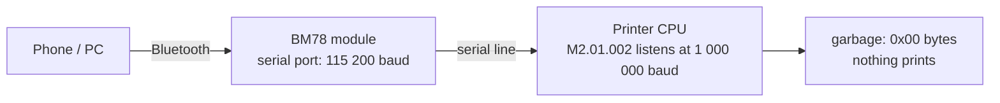

<div align="center">

# TSC Alpha‑40L · Bluetooth fix for firmware M2.01.002

**Your printer pairs over Bluetooth but prints nothing?** Firmware M2.01.002 talks to the Bluetooth
module at the wrong speed. This repository explains why and fixes it — with a 3‑byte patch to TSC's
own firmware file, applied on your computer.

[**Open the web patcher →**](https://andreyyb5.github.io/tsc-alpha-bluetooth-fix/) &nbsp;·&nbsp;
[How it was found](docs/technical.md) &nbsp;·&nbsp; [Русская версия](README.ru.md)

[](https://github.com/AndreyyB5/tsc-alpha-bluetooth-fix/actions/workflows/tests.yml)

 &nbsp;


<sub>Real screenshots read from the printer's screen memory: before, and after the fixed firmware
with the optional logo and Dual mode.</sub>

</div>

## The problem

After updating a **TSC Alpha‑40L** to **M2.01.002 EZC**:

- the printer pairs with a phone or computer, the Bluetooth icon lights up, «Test connection» passes;
- jobs sent over Bluetooth never print; in Bluetooth dump mode the printer shows only `00` bytes;
- USB and Wi‑Fi keep working, and going back to B1.x firmware is not offered by TSC.

It affects printers with the **Microchip BM78** Bluetooth module. Check yours over USB:
`OUT GETSETTING$("CONFIG","BT","MODULE")` → `BM78 MFi`.

## Why



When the firmware opens the Bluetooth module for printing it sets the CPU side of the serial line to
**1 000 000 baud** (1 024 000 in practice). The BM78 module is configured for **115 200** — the same
firmware even uses 115 200 itself to talk to the module in setup mode. Every byte arrives
mangled. The fix changes one instruction pair in that function:

```
0x202EDBF0   mov r0, #0xF4000 ; orr r0, r0, #0x240    @ 1 000 000 baud   (original)
0x202EDBF0   mov r0, #0x1C000 ; orr r0, r0, #0x200    @   115 200 baud   (fixed)
```

Only 3 bytes of code and the two checksums change; the file keeps its size and structure.
[Full write‑up →](docs/technical.md)

## Fix it

You need TSC's official file **`ALPHA40L_EZC_M2.01.002.NEW`** (3 604 516 bytes, SHA‑256
`152e5a55…f63329`) from tscprinters.com → Support → Downloads → Alpha‑40L → Firmware.
TSC's firmware is not hosted here — you patch your own copy.

| | How | Good for |
|---|---|---|
| **Web patcher** | [open the page](https://andreyyb5.github.io/tsc-alpha-bluetooth-fix/), drop the file, download the result | everyone; nothing is uploaded |
| **Command line** | `python3 patch.py ALPHA40L_EZC_M2.01.002.NEW --dual --logo docs/assets/marker-logo.bmp` | scripts, no browser (Python 3.9+, no packages) |
| **No reflash** | install [`tools/AUTO.BAS`](tools/AUTO.BAS) on the printer | trying it first; fully reversible |

The result must be **`18dd03667cd3d85812c341150319287ff63cb030f0db9061a6812e95cf61f1e1`** — the exact
file that was flashed and tested. The patcher refuses any other input and checks its output.

### Send it to the printer

1. **Windows:** TSC DiagTool → File Manager → file type «Firmware File» → Download.
   Or the printer driver → Printer properties → Tools → Send File To Printer.
   **macOS / Linux:** `python3 tools/tsc_usb.py send ALPHA40L_EZC_M2.01.002_BTFIX.NEW`.
2. The printer checks the file, writes it and restarts by itself (about 20 s). Keep it powered.
3. Check: `OUT PEEK32(539941872)` → `3818916103` (original firmware: `3818916596`),
   or `python3 tools/tsc_usb.py info` → `fix  fixed firmware`.

## Extras (optional, both tested)

- **Dual mode** (`--dual`). The menu offers *either* classic Bluetooth *or* Bluetooth LE. `BT MODE Dual`
  enables both, so Android/PC (classic) and iPhone apps (LE only) work at the same time. The mode is
  applied when the printer starts.
- **Home‑screen logo** (`--logo FILE.bmp`). A 24‑bit BMP up to 320×140 replaces the word «Ready».
  The web page converts any picture. Remove it with `KILL S,"LOGO.LCD"` and a restart.
  [`docs/assets/marker-logo.bmp`](docs/assets/marker-logo.bmp) is ours — Barsik the cat says hi.

## For app developers: Bluetooth LE

The BM78 exposes Microchip's transparent UART service `49535343‑FE7D‑4AE5‑8FA9‑9FAFD205E455`.
**Subscribe to notifications of `49535343‑1E4D‑4BD9‑BA61‑23C647249616` before writing**, or the module
forwards only the first packet and then stalls (writes with response time out). Measured: 157 of
7 000 bytes without the subscription, 7 000 of 7 000 with it.

## Undo

- Flash the official `ALPHA40L_EZC_M2.01.002.NEW` again (Bluetooth stops printing again).
- No‑reflash fix: `KILL F,"AUTO.BAS"` and restart. Logo: `KILL S,"LOGO.LCD"`. Mode: `BT MODE BT3.0`.

## Status

| Model | Firmware | Status |
|---|---|---|
| Alpha‑40L | M2.01.002 EZC | ✅ fixed and tested: Bluetooth classic and LE, logo, Dual mode |
| Alpha‑30L | M2.01.002 EZC | 🔬 same bug in the same code; patch is being tested on a real printer |

## Repository

```
patch.py              build the fixed file (CLI)
tscfw.py              firmware file format: checksums, LZSS, in-place rebuild
docs/index.html       web patcher (GitHub Pages), logic in docs/patcher.mjs
docs/patches/*.json   patch definitions: input/output SHA-256 and byte edits
docs/technical.md     how the bug was found, file format, memory map
tools/tsc_usb.py      USB helper for macOS/Linux: info, send, Bluetooth mode
tools/AUTO.BAS        the no-reflash fix
tests/                python -m unittest discover -s tests · node --test tests/*.test.mjs
```

## Disclaimer

Not affiliated with TSC. Firmware and trademarks belong to their owners; no TSC firmware is
distributed here. Flashing firmware is at your own risk — although the printer only accepts a file
whose checksums match, and the patched file was tested on real hardware.

Made by the team behind **Marker**. Code under the [MIT license](LICENSE).
