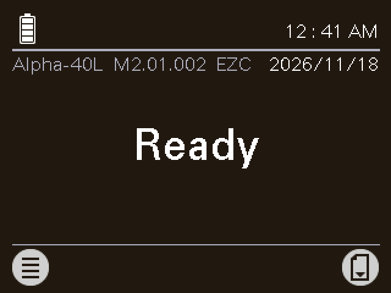
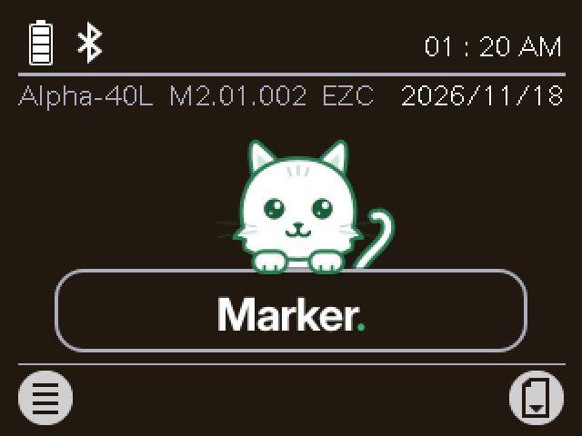
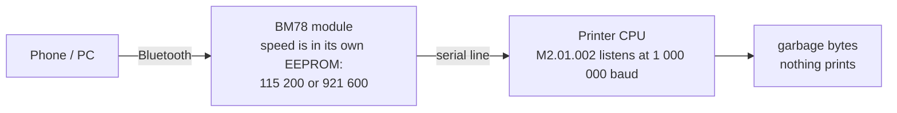
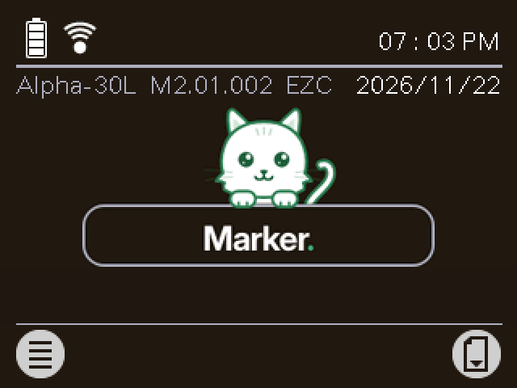

<div align="center">

# TSC Alpha‑40L / 30L · Bluetooth fix for firmware M2.01.002

**Your printer pairs over Bluetooth but prints nothing?** There is not one cause but three, and the fix
for one printer can be useless on the next one of the same model. This page tells you which one you
have and fixes it — with a tiny patch to TSC's own firmware file, applied on your computer.

[**Open the web patcher →**](https://andreyyb5.github.io/tsc-alpha-bluetooth-fix/) &nbsp;·&nbsp;
[How it was found](docs/technical.md) &nbsp;·&nbsp; [Русская версия](README.ru.md)

[](https://github.com/AndreyyB5/tsc-alpha-bluetooth-fix/actions/workflows/tests.yml)

 &nbsp;


<sub>Real screenshots read from the printer's screen memory: before, and after the fixed firmware
with the optional logo and Dual mode.</sub>

</div>

## The phenomenon: same printer, same firmware, different result

We fixed one **Alpha‑40L**, and a second one — same model, same firmware, same Bluetooth module — kept
printing nothing. The fix was right; the **module itself** was set to a different speed:

| | Printer A | Printer B |
|---|---|---|
| Module | Microchip BM78 | Microchip BM78 |
| The module's own serial speed (its EEPROM byte `0x31`) | `0x03` = **115 200** | `0x11` = **921 600** |
| TSC's M2.01.002, which opens the module at 1 000 000 | prints nothing | prints nothing |
| After the 115 200 fix | **prints** | still nothing: it receives garbage |
| After the 921 600 fix | — | **prints** |

The factory firmware matches **neither** module. The speed lives in the module's own EEPROM; TSC's
firmware never writes that byte (checked in M2.01.002 and B1.15), so two printers of one model can
differ. A fix built for one speed leaves the other printer as broken as before — and it looks as if
the fix did nothing. **Read your module's speed first** (next section), then build the matching file.



## Which one is yours?

```
python3 tools/tsc_usb.py info
```

(macOS / Linux, printer on USB). On Windows send `OUT PEEK32(547429728)` from DiagTool and paste the
number into the web patcher. `info` prints the module, its speed, the mode and what to do:

| What you see | Cause | Do this |
|---|---|---|
| Alpha‑40L, `bt speed 115200 (module code 0x03)` | serial speed | build the default file (`--speed 115200`) |
| Alpha‑40L, `bt speed 921600 (module code 0x11)` | serial speed | build with `--speed 921600` |
| any printer, `bt mode BT4.0` | Bluetooth LE only: classic Bluetooth (SPP) is off | `tools/tsc_usb.py btmode Dual` |
| Alpha‑30L, `bt module xPico270` | no speed bug, see [Alpha‑30L](#alpha-30l) | Dual mode, no firmware change |

Already flashed a fix and still nothing prints? `DUMP_BT 0,64` over USB shows what reaches the printer:
readable print commands are fine, anything else means the module speed and the firmware do not match —
build the other variant.

> [!IMPORTANT]
> **After flashing the Bluetooth mode was back to BT4.0 (LE only)** on the Alpha‑40L we measured. Run
> `btmode Dual` again after every flash, or phones and PCs that print over classic Bluetooth see nothing.

## Why the serial speed matters

When the firmware opens the Bluetooth module for printing it sets the CPU side of the serial line to
**1 000 000 baud** (1 024 000 in practice), while the module runs at its own speed. Every byte arrives
mangled. The fix changes one instruction pair in that function, to whichever speed the module has:

```
0x202EDBF0   mov r0, #0xF4000 ; orr r0, r0, #0x240    @ 1 000 000 baud   (original)
0x202EDBF0   mov r0, #0x1C000 ; orr r0, r0, #0x200    @   115 200 baud   (fixed, code 03)
0x202EDBF0   mov r0, #0xE1000 ; orr r0, r0, #0        @   921 600 baud   (fixed, code 11)
```

Only a few bytes of code and the two checksums change; the file keeps its size and structure.
[Full write‑up →](docs/technical.md)

## Fix it

You need TSC's official file **`ALPHA40L_EZC_M2.01.002.NEW`** (3 604 516 bytes, SHA‑256
`152e5a55…f63329`) from tscprinters.com → Support → Downloads → Alpha‑40L → Firmware.
TSC's firmware is not hosted here — you patch your own copy.

| | How | Good for |
|---|---|---|
| **Web patcher** | [open the page](https://andreyyb5.github.io/tsc-alpha-bluetooth-fix/), drop the file, pick the speed, download the result | everyone; nothing is uploaded |
| **Command line** | `python3 patch.py ALPHA40L_EZC_M2.01.002.NEW [--speed 921600] --dual --logo docs/assets/marker-logo.bmp` | scripts, no browser (Python 3.9+, no packages) |
| **No reflash** | install [`tools/AUTO.BAS`](tools/AUTO.BAS) on the printer | modules at 115 200 (code 03) only; fully reversible |

The result is the exact file that was flashed and tested:

| Module speed | Output SHA‑256 |
|---|---|
| 115 200 (code `0x03`) | `18dd03667cd3d85812c341150319287ff63cb030f0db9061a6812e95cf61f1e1` |
| 921 600 (code `0x11`) | `fa41dafd25e160355cf8b0ee3c8a3918ac97c2a5ef586611c55035c9c5f4868b` |

The patcher refuses any other input and checks its output.

### Send it to the printer

1. **Windows:** TSC DiagTool → File Manager → file type «Firmware File» → Download.
   Or the printer driver → Printer properties → Tools → Send File To Printer.
   **macOS / Linux:** `python3 tools/tsc_usb.py send FILE`. It refuses a file for another model
   or for another module speed — the Alpha‑40L and Alpha‑30L files carry the same tag.
2. The printer checks the file, writes it and restarts by itself (about 20 s). Keep it powered.
3. Check: `OUT PEEK32(539941872)` → `3818916103` (115 200) or `3818916577` (921 600);
   the original firmware answers `3818916596`. Or simply `python3 tools/tsc_usb.py info`.
4. Set the mode again: `python3 tools/tsc_usb.py btmode Dual`.

## Alpha‑30L

The Alpha‑30L we had in hand has a different Bluetooth module — Lantronix **xPico270** (Wi‑Fi + Bluetooth)
instead of the BM78 — and **no speed bug**. Nothing in the firmware bytes changes there. What mattered:

- **The mode.** The printer was in BT4.0 (LE only): everything that prints over classic Bluetooth saw
  nothing. `BT MODE Dual` and a restart switch both on.
- **The home screen.** With Wi‑Fi connected the printer draws its IP address over the bottom of the
  screen and covers the lower part of the logo. Keep the picture in the **top 107 of 138 rows**:
  [`docs/assets/marker-logo-30l.bmp`](docs/assets/marker-logo-30l.bmp) does.



<sub>Alpha‑30L home screen read from the printer's memory (the address line is left empty here).</sub>

Build the file with `python3 patch.py ALPHA30L_EZC_M2.01.002.NEW --dual --logo docs/assets/marker-logo-30l.bmp`
(SHA‑256 of TSC's file `98636b38…ea728fa4`, 3 080 228 bytes), or just send the logo and the mode to a printer
that already runs M2.01.002: `patch.py --logo … -o LOGO.prn`, `tsc_usb.py send LOGO.prn`, `btmode Dual`.

> On the xPico270 we measured (module firmware 5.2.1.0R5) **classic Bluetooth (SPP) is not served**: at start‑up
> the module never reports «Started SPP», so the printer does not bind it, and when the line is forced
> (`SPP_1`) the module answers «Invalid line name». Bluetooth LE is served: the print line is bound and waiting.
> **App developers:** the print service is `49535343‑FE7D‑4AE5‑8FA9‑9FAFD205E455`, write to
> `49535343‑8841‑43F4‑A8D4‑ECBE34729BB3`. The module also has its own BLE Wi‑Fi provisioning service, so match
> the UUIDs — do not take «the first writable characteristic».

## Extras (optional, both tested)

- **Dual mode** (`--dual`). The menu offers *either* classic Bluetooth *or* Bluetooth LE. `BT MODE Dual`
  enables both, so Android/PC (classic) and iPhone apps (LE only) work at the same time. The mode is
  applied when the printer starts.
- **Home‑screen logo** (`--logo FILE.bmp`). A 24‑bit BMP up to 320×140 replaces the word «Ready».
  The web page converts any picture. Remove it with `KILL S,"LOGO.LCD"` and a restart.
  [`docs/assets/marker-logo.bmp`](docs/assets/marker-logo.bmp) is ours — Barsik the cat says hi.

## For app developers: Bluetooth LE on the BM78

The BM78 exposes Microchip's transparent UART service `49535343‑FE7D‑4AE5‑8FA9‑9FAFD205E455`.
**Subscribe to notifications of `49535343‑1E4D‑4BD9‑BA61‑23C647249616` before writing**, or the module
forwards only the first packet and then stalls (writes with response time out). Measured: 157 of
7 000 bytes without the subscription, 7 000 of 7 000 with it.

## Undo

- Flash the official `.NEW` again (Bluetooth stops printing again).
- No‑reflash fix: `KILL F,"AUTO.BAS"` and restart. Logo: `KILL S,"LOGO.LCD"`. Mode: `BT MODE BT3.0`.

## Status

| Model | Bluetooth module | Firmware | Status |
|---|---|---|---|
| Alpha‑40L | BM78, speed code `0x03` (115 200) | M2.01.002 EZC | ✅ fixed and tested: Bluetooth classic and LE, logo, Dual mode |
| Alpha‑40L | BM78, speed code `0x11` (921 600) | M2.01.002 EZC | ✅ fixed and tested: printed from a phone, logo, Dual mode |
| Alpha‑30L | xPico270 (Wi‑Fi + Bluetooth) | M2.01.002 EZC | ✅ Dual mode and logo tested on a live printer; the combined file was not flashed; SPP not served |
| Alpha‑30L | BM78 | M2.01.002 EZC | same code as the 40L; no such printer to test |

## Repository

```
patch.py              build the fixed file (CLI): --speed, --dual, --logo
tscfw.py              firmware file format: checksums, LZSS, in-place rebuild
docs/index.html       web patcher (GitHub Pages), logic in docs/patcher.mjs
docs/patches/*.json   patch definitions: input/output SHA-256 and byte edits, one per module speed
docs/technical.md     how the bug was found, file format, memory map
tools/tsc_usb.py      USB helper for macOS/Linux: info, send, Bluetooth mode
tools/AUTO.BAS        the no-reflash fix (modules at 115 200 only)
tests/                python -m unittest discover -s tests · node --test tests/*.test.mjs
```

## Disclaimer

Not affiliated with TSC. Firmware and trademarks belong to their owners; no TSC firmware is
distributed here. Flashing firmware is at your own risk — although the printer only accepts a file
whose checksums match, and the patched files were tested on real hardware.

Made by the team behind **Marker**. Code under the [MIT license](LICENSE).
