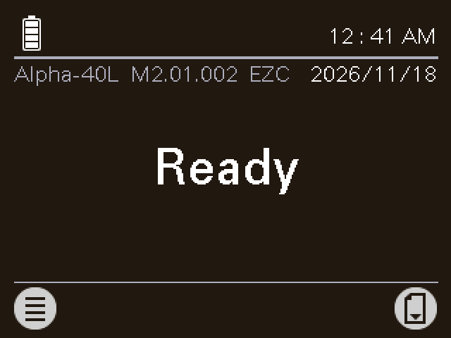

<div align="center">

# TSC Alpha‑40L · починка Bluetooth для прошивки M2.01.002

**Принтер сопрягается по Bluetooth, но ничего не печатает?** Прошивка M2.01.002 говорит с модулем
Bluetooth не на той скорости. Здесь объяснено почему и как это исправить: правкой 3 байт в
официальном файле прошивки TSC, прямо на вашем компьютере.

[**Открыть веб‑патчер →**](https://andreyyb5.github.io/tsc-alpha-bluetooth-fix/) &nbsp;·&nbsp;
[Как это нашли (англ.)](docs/technical.md) &nbsp;·&nbsp; [English](README.md)

 &nbsp;


<sub>Настоящие снимки, прочитанные из памяти экрана принтера: до и после исправленной прошивки
с логотипом и режимом Dual.</sub>

</div>

## Что происходит

После обновления **TSC Alpha‑40L** до **M2.01.002 EZC**:

- принтер сопрягается с телефоном или компьютером, значок Bluetooth горит, «Тест связи» проходит;
- задания по Bluetooth не печатаются; в режиме дампа Bluetooth принтер показывает только байты `00`;
- USB и Wi‑Fi работают, а вернуть прошивку B1.x TSC не предлагает.

Касается принтеров с модулем Bluetooth **Microchip BM78**. Проверить по USB:
`OUT GETSETTING$("CONFIG","BT","MODULE")` → `BM78 MFi`.

## Почему


Открывая модуль Bluetooth для печати, прошивка ставит своей стороне линии **1 000 000 бод**
(на деле 1 024 000). Модуль BM78 настроен на **115 200**, и эта же прошивка сама говорит с ним на
115 200, когда настраивает его. Каждый байт приходит искажённым. Исправление меняет одну пару
инструкций в этой функции:

```
0x202EDBF0   mov r0, #0xF4000 ; orr r0, r0, #0x240    @ 1 000 000 бод   (было)
0x202EDBF0   mov r0, #0x1C000 ; orr r0, r0, #0x200    @   115 200 бод   (стало)
```

Меняются 3 байта кода и две контрольные суммы. Размер и строение файла те же.

## Как исправить

Нужен официальный файл TSC **`ALPHA40L_EZC_M2.01.002.NEW`** (3 604 516 байт, SHA‑256
`152e5a55…f63329`): tscprinters.com → Support → Downloads → Alpha‑40L → Firmware.
Прошивки TSC здесь нет: вы исправляете свою копию.

| | Как | Кому |
|---|---|---|
| **Веб‑патчер** | [открыть страницу](https://andreyyb5.github.io/tsc-alpha-bluetooth-fix/), перетащить файл, скачать результат | всем; файл никуда не загружается |
| **Командная строка** | `python3 patch.py ALPHA40L_EZC_M2.01.002.NEW --dual --logo docs/assets/marker-logo.bmp` | без браузера (Python 3.9+, без пакетов) |
| **Без перепрошивки** | записать на принтер [`tools/AUTO.BAS`](tools/AUTO.BAS) | попробовать сначала; полностью обратимо |

SHA‑256 результата должна быть **`18dd03667cd3d85812c341150319287ff63cb030f0db9061a6812e95cf61f1e1`** —
это ровно тот файл, что был залит и проверен. Патчер не примет другой файл и проверит свой результат.

### Как залить

1. **Windows:** TSC DiagTool → File Manager → тип файла «Firmware File» → Download.
   Или драйвер принтера → Свойства принтера → Tools → Send File To Printer.
   **macOS / Linux:** `python3 tools/tsc_usb.py send ALPHA40L_EZC_M2.01.002_BTFIX.NEW`.
2. Принтер проверит файл, запишет его и сам перезагрузится (около 20 с). Не выключайте его.
3. Проверка: `OUT PEEK32(539941872)` → `3818916103` (у заводской прошивки `3818916596`),
   или `python3 tools/tsc_usb.py info` → `fix  fixed firmware`.

## Дополнительно (по желанию, оба проверены)

- **Режим Dual** (`--dual`). В меню можно выбрать *либо* обычный Bluetooth, *либо* Bluetooth LE.
  Команда `BT MODE Dual` включает оба: Android и ПК (обычный) и приложения на iPhone (только LE)
  работают одновременно. Режим применяется при включении принтера.
- **Логотип на главном экране** (`--logo ФАЙЛ.bmp`). BMP 24 бита до 320×140 вместо слова «Ready».
  Веб‑страница сама переведёт любую картинку. Убрать: `KILL S,"LOGO.LCD"` и перезапуск.
  [`docs/assets/marker-logo.bmp`](docs/assets/marker-logo.bmp) — наш, с котом Барсиком.

## Разработчикам приложений: Bluetooth LE

У BM78 сервис прозрачного UART Microchip `49535343‑FE7D‑4AE5‑8FA9‑9FAFD205E455`.
**До записи подпишитесь на уведомления `49535343‑1E4D‑4BD9‑BA61‑23C647249616`**, иначе модуль
пропустит только первый пакет и замолчит (запись с ответом упадёт по таймауту). Замер: без подписки
дошло 157 байт из 7 000, с подпиской — 7 000 из 7 000.

## Как вернуть

- Залить официальный `ALPHA40L_EZC_M2.01.002.NEW` (Bluetooth снова перестанет печатать).
- Без перепрошивки: `KILL F,"AUTO.BAS"` и перезапуск. Логотип: `KILL S,"LOGO.LCD"`. Режим: `BT MODE BT3.0`.

## Состояние

| Модель | Прошивка | Состояние |
|---|---|---|
| Alpha‑40L | M2.01.002 EZC | ✅ исправлено и проверено: обычный Bluetooth и LE, логотип, режим Dual |
| Alpha‑30L | M2.01.002 EZC | 🔬 та же ошибка в том же коде; правка проверяется на живом принтере |

## Отказ от ответственности

Проект не связан с TSC. Прошивка и товарные знаки принадлежат их владельцам, прошивка TSC здесь
не распространяется. Перепрошивка — на ваш риск, хотя принтер принимает только файл с верными
контрольными суммами, а исправленный файл проверен на живом принтере.

Сделано командой **Marker**. Код под [лицензией MIT](LICENSE).
