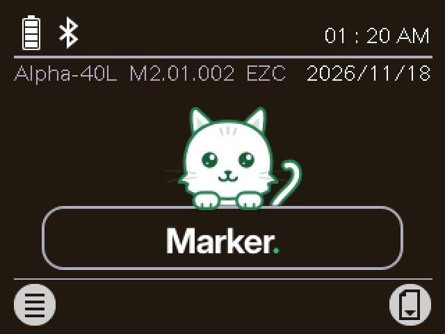

<div align="center">

# TSC Alpha‑40L / 30L · починка Bluetooth для прошивки M2.01.002

**Принтер сопрягается по Bluetooth, но ничего не печатает?** Причина не одна, и правка, которая помогла
одному принтеру, может быть бесполезна на таком же соседнем. Здесь написано, какая причина у вас и как
её исправить: правкой нескольких байт в официальном файле прошивки TSC, прямо на вашем компьютере.

[**Открыть веб‑патчер →**](https://andreyyb5.github.io/tsc-alpha-bluetooth-fix/) &nbsp;·&nbsp;
[Как это нашли (англ.)](docs/technical.md) &nbsp;·&nbsp; [English](README.md)

 &nbsp;


<sub>Настоящие снимки, прочитанные из памяти экрана принтера: до и после исправленной прошивки
с логотипом и режимом Dual.</sub>

</div>

## Феномен: принтер тот же, прошивка та же, результат разный

Мы починили один **Alpha‑40L**, а второй — та же модель, та же прошивка, тот же модуль Bluetooth — так
и не печатал. Правка была верной. Дело оказалось в **самом модуле**: у второго он настроен на другую скорость:

| | Принтер А | Принтер Б |
|---|---|---|
| Модуль | Microchip BM78 | Microchip BM78 |
| Своя скорость порта модуля (байт `0x31` его EEPROM) | `0x03` = **115 200** | `0x11` = **921 600** |
| M2.01.002 открывает модуль на 1 000 000 | не печатает | не печатает |
| После правки на 115 200 | **печатает** | не печатает: принтер получает мусор |
| После правки на 921 600 | — | **печатает** |

Заводская прошивка не совпадает **ни с одним** из модулей. Скорость лежит в EEPROM самого модуля, прошивка
TSC этот байт не записывает (проверено в M2.01.002 и B1.15), поэтому у двух одинаковых принтеров она может
различаться. Правка под одну скорость оставляет другой принтер сломанным, и кажется, будто «ничего не
помогло». **Сначала узнайте скорость своего модуля** (следующий раздел), потом соберите подходящий файл.


## Какая причина у вас?

```
python3 tools/tsc_usb.py info
```

(macOS / Linux, принтер по USB). В Windows отправьте из DiagTool `OUT PEEK32(547429728)` и вставьте
число в веб‑патчер. Команда `info` покажет модуль, его скорость, режим и что делать:

| Что вы видите | Причина | Что сделать |
|---|---|---|
| Alpha‑40L, `bt speed 115200 (module code 0x03)` | скорость порта | собрать обычный файл (`--speed 115200`) |
| Alpha‑40L, `bt speed 921600 (module code 0x11)` | скорость порта | собрать с `--speed 921600` |
| любой принтер, `bt mode BT4.0` | только Bluetooth LE, обычный Bluetooth (SPP) выключен | `tools/tsc_usb.py btmode Dual` |
| Alpha‑30L, `bt module xPico270` | ошибки скорости нет, см. [Alpha‑30L](#alpha-30l) | режим Dual, прошивка не меняется |

Уже прошили исправленный файл, а принтер молчит? `DUMP_BT 0,64` по USB покажет, что доходит до принтера.
Читаемые команды печати — всё в порядке; любой другой набор байт значит, что скорость модуля и прошивка
не совпали: соберите другой вариант.

> [!IMPORTANT]
> **После перепрошивки режим Bluetooth снова стал BT4.0 (только LE)** — на принтере, который мы мерили.
> После каждой прошивки запускайте `btmode Dual`, иначе телефоны и компьютеры с обычным Bluetooth молчат.

## Почему важна скорость порта

Открывая модуль Bluetooth для печати, прошивка ставит своей стороне линии **1 000 000 бод** (на деле
1 024 000), а модуль работает на своей. Каждый байт приходит искажённым. Исправление меняет одну пару
инструкций в этой функции на скорость, которую имеет ваш модуль:

```
0x202EDBF0   mov r0, #0xF4000 ; orr r0, r0, #0x240    @ 1 000 000 бод   (было)
0x202EDBF0   mov r0, #0x1C000 ; orr r0, r0, #0x200    @   115 200 бод   (стало, код 03)
0x202EDBF0   mov r0, #0xE1000 ; orr r0, r0, #0        @   921 600 бод   (стало, код 11)
```

Меняются считаные байты кода и две контрольные суммы. Размер и строение файла те же.

## Как исправить

Нужен официальный файл TSC **`ALPHA40L_EZC_M2.01.002.NEW`** (3 604 516 байт, SHA‑256
`152e5a55…f63329`): tscprinters.com → Support → Downloads → Alpha‑40L → Firmware.
Прошивки TSC здесь нет: вы исправляете свою копию.

| | Как | Кому |
|---|---|---|
| **Веб‑патчер** | [открыть страницу](https://andreyyb5.github.io/tsc-alpha-bluetooth-fix/), перетащить файл, выбрать скорость, скачать результат | всем; файл никуда не загружается |
| **Командная строка** | `python3 patch.py ALPHA40L_EZC_M2.01.002.NEW [--speed 921600] --dual --logo docs/assets/marker-logo.bmp` | без браузера (Python 3.9+, без пакетов) |
| **Без перепрошивки** | записать на принтер [`tools/AUTO.BAS`](tools/AUTO.BAS) | только модули на 115 200 (код 03); полностью обратимо |

Результат — ровно тот файл, что был залит и проверен:

| Скорость модуля | SHA‑256 результата |
|---|---|
| 115 200 (код `0x03`) | `18dd03667cd3d85812c341150319287ff63cb030f0db9061a6812e95cf61f1e1` |
| 921 600 (код `0x11`) | `fa41dafd25e160355cf8b0ee3c8a3918ac97c2a5ef586611c55035c9c5f4868b` |

Патчер не примет другой файл и проверит свой результат.

### Как залить

1. **Windows:** TSC DiagTool → File Manager → тип файла «Firmware File» → Download.
   Или драйвер принтера → Свойства принтера → Tools → Send File To Printer.
   **macOS / Linux:** `python3 tools/tsc_usb.py send ФАЙЛ`. Программа не зальёт файл от другой модели или
   под другую скорость модуля: у Alpha‑40L и Alpha‑30L в заголовке одна и та же метка.
2. Принтер проверит файл, запишет его и сам перезагрузится (около 20 с). Не выключайте его.
3. Проверка: `OUT PEEK32(539941872)` → `3818916103` (115 200) или `3818916577` (921 600);
   у заводской прошивки `3818916596`. Или просто `python3 tools/tsc_usb.py info`.
4. Снова включите режим: `python3 tools/tsc_usb.py btmode Dual`.

## Alpha‑30L

У Alpha‑30L, который был под рукой, другой модуль Bluetooth — Lantronix **xPico270** (Wi‑Fi + Bluetooth) вместо
BM78, и **ошибки скорости у него нет**. Байты прошивки менять не нужно. Важно было другое:

- **Режим.** Принтер стоял в BT4.0 (только LE): всё, что печатает по обычному Bluetooth, ничего не видело.
  `BT MODE Dual` и перезапуск включают оба.
- **Главный экран.** Когда есть Wi‑Fi, принтер рисует свой IP‑адрес поверх нижней части экрана и закрывает
  низ логотипа. Картинка должна занимать **верхние 107 строк из 138**: так сделан
  [`docs/assets/marker-logo-30l.bmp`](docs/assets/marker-logo-30l.bmp).


<sub>Главный экран Alpha‑30L, прочитанный из памяти принтера (строка адреса здесь пустая).</sub>

Собрать файл: `python3 patch.py ALPHA30L_EZC_M2.01.002.NEW --dual --logo docs/assets/marker-logo-30l.bmp`
(SHA‑256 файла TSC `98636b38…ea728fa4`, 3 080 228 байт). Или отправить логотип и режим на принтер, где уже
стоит M2.01.002: `patch.py --logo … -o LOGO.prn`, `tsc_usb.py send LOGO.prn`, `btmode Dual`.

> На измеренном xPico270 (прошивка модуля 5.2.1.0R5) **обычный Bluetooth (SPP) не обслуживается**: при запуске
> модуль не сообщает «Started SPP», и принтер его не привязывает, а на принудительную привязку линии `SPP_1`
> модуль отвечает «Invalid line name». Bluetooth LE обслуживается: линия печати привязана и ждёт данных.
> **Разработчикам приложений:** сервис печати `49535343‑FE7D‑4AE5‑8FA9‑9FAFD205E455`, писать в
> `49535343‑8841‑43F4‑A8D4‑ECBE34729BB3`. У модуля есть и свой сервис настройки Wi‑Fi по BLE, поэтому
> сверяйте UUID, а не берите «первую характеристику для записи».

## Дополнительно (по желанию, оба проверены)

- **Режим Dual** (`--dual`). В меню можно выбрать *либо* обычный Bluetooth, *либо* Bluetooth LE.
  Команда `BT MODE Dual` включает оба: Android и ПК (обычный) и приложения на iPhone (только LE)
  работают одновременно. Режим применяется при включении принтера.
- **Логотип на главном экране** (`--logo ФАЙЛ.bmp`). BMP 24 бита до 320×140 вместо слова «Ready».
  Веб‑страница сама переведёт любую картинку. Убрать: `KILL S,"LOGO.LCD"` и перезапуск.
  [`docs/assets/marker-logo.bmp`](docs/assets/marker-logo.bmp) — наш, с котом Барсиком.

## Разработчикам приложений: Bluetooth LE на BM78

У BM78 сервис прозрачного UART Microchip `49535343‑FE7D‑4AE5‑8FA9‑9FAFD205E455`.
**До записи подпишитесь на уведомления `49535343‑1E4D‑4BD9‑BA61‑23C647249616`**, иначе модуль
пропустит только первый пакет и замолчит (запись с ответом упадёт по таймауту). Замер: без подписки
дошло 157 байт из 7 000, с подпиской — 7 000 из 7 000.

## Как вернуть

- Залить официальный файл `.NEW` (Bluetooth снова перестанет печатать).
- Без перепрошивки: `KILL F,"AUTO.BAS"` и перезапуск. Логотип: `KILL S,"LOGO.LCD"`. Режим: `BT MODE BT3.0`.

## Состояние

| Модель | Модуль Bluetooth | Прошивка | Состояние |
|---|---|---|---|
| Alpha‑40L | BM78, код скорости `0x03` (115 200) | M2.01.002 EZC | ✅ исправлено и проверено: обычный Bluetooth и LE, логотип, Dual |
| Alpha‑40L | BM78, код скорости `0x11` (921 600) | M2.01.002 EZC | ✅ исправлено и проверено: печать с телефона, логотип, Dual |
| Alpha‑30L | xPico270 (Wi‑Fi + Bluetooth) | M2.01.002 EZC | ✅ Dual и логотип проверены на живом принтере; общий файл не заливали; SPP не обслуживается |
| Alpha‑30L | BM78 | M2.01.002 EZC | код тот же, что у 40L; такого принтера для проверки не было |

## Отказ от ответственности

Проект не связан с TSC. Прошивка и товарные знаки принадлежат их владельцам, прошивка TSC здесь
не распространяется. Перепрошивка — на ваш риск, хотя принтер принимает только файл с верными
контрольными суммами, а исправленные файлы проверены на живых принтерах.

Сделано командой **Marker**. Код под [лицензией MIT](LICENSE).
